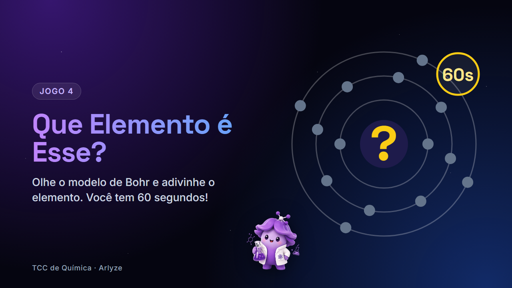

# Que Elemento é Esse?



Jogo educativo de Química (TCC) inspirado no "Quem é esse Pokémon?". O aluno vê o **modelo de Bohr** de um elemento da tabela periódica e precisa descobrir qual é. São **60 segundos** para acertar o máximo possível.

Não tem ranking: a ideia é o aluno treinar e se divertir ao mesmo tempo.

## Objetivo pedagógico

- Relacionar **número atômico**, **prótons** e **elétrons**.
- Entender a **distribuição eletrônica em camadas** (K, L, M, N) do modelo de Bohr.
- Calcular **nêutrons** a partir da massa atômica.
- Associar **símbolo** e **nome** dos elementos.
- Conhecer dados reais de cada elemento (massa, grupo, estado físico, configuração eletrônica e ano de descoberta).

## Como rodar

O jogo é só HTML, CSS e JavaScript. Precisa de internet, porque as bibliotecas vêm por CDN e os dados vêm da PubChem.

| Jeito | Como |
|---|---|
| Dois cliques | Abra o `index.html` direto no navegador |
| Servidor local | `python server.py` e abra **http://localhost:8000** |
| Hospedado | Suba a pasta na **Vercel** (ou qualquer hospedagem estática) |

## Como jogar

1. Escolha um **nível**.
2. Observe o **modelo de Bohr**:
   - o **núcleo** mostra o símbolo (ou `?` no nível 3), os prótons (`p⁺`) e os nêutrons (`n`);
   - cada **anel** é uma camada, com a quantidade de elétrons escrita em cima (ex.: `L · 8e⁻`);
   - cada **bolinha amarela** girando é um elétron.
3. Use as **pistas** da coluna da direita.
4. Clique numa das **4 alternativas** embaixo do modelo, no estilo Kahoot (vermelho, azul, amarelo e verde).
5. O jogo revela o elemento, mostra os dados da **PubChem** e passa para o próximo.
6. Quando o tempo acaba, aparecem **pontos, acertos e erros**, com opções de jogar de novo ou subir de nível.

Na primeira vez, a **Arly** (mascote) faz um tutorial usando o carbono. Ele pode ser aberto de novo em **Como jogar**.

## Níveis

| Nível | Pistas | Acerto | Erro |
|---|---|---|---|
| 1 | Símbolo, camadas, prótons, nêutrons e elétrons | +5 | −3 |
| 2 | Símbolo, prótons, nêutrons e elétrons | +8 | −2 |
| 3 | Prótons, nêutrons e elétrons (sem o símbolo) | +10 | −1 |

Em todos os níveis o modelo de Bohr aparece. A pontuação nunca fica abaixo de zero.

## PubChem

Ao abrir, o jogo faz **uma única consulta** à tabela periódica da PubChem:

```
https://pubchem.ncbi.nlm.nih.gov/rest/pug/periodictable/JSON
```

Dela vêm a massa atômica (usada para calcular os nêutrons), o grupo, o estado físico a 25 °C, a configuração eletrônica e o ano de descoberta. Os termos são traduzidos para português.

Se a PubChem estiver fora do ar, o jogo **continua funcionando** com os dados locais de `elementos.js`, só sem o cartão de dados.

Os nomes em português e a distribuição por camadas ficam no `elementos.js`, porque a PubChem só tem nomes em inglês e não traz os elétrons por camada.

## Tecnologias

| Tecnologia | Uso |
|---|---|
| HTML + JavaScript puro | Estrutura e lógica do jogo, sem build |
| Tailwind CSS (CDN) | Estilos |
| Lucide (CDN) | Ícones (o jogo não usa emoji) |
| SVG | Modelo de Bohr animado |
| PubChem REST API | Dados reais dos elementos |
| Python | Servidor local opcional |

## Arquivos

| Arquivo | O que faz |
|---|---|
| `index.html` | Página, layout travado na altura da tela e estilos |
| `jogo.js` | Consulta à PubChem, modelo de Bohr, rodadas, cronômetro, tutorial e fluxo do jogo |
| `elementos.js` | Elementos (H até Kr), distribuição por camadas e regras de cada nível |
| `server.py` | Servidor local para testar no computador |
| `arly.png` | Mascote |

## Personalizar

**Adicionar um elemento:** em `elementos.js`, no fim da lista `DADOS` (a ordem define o número atômico):

```js
['Rb', 'Rubídio', 85],
//  símbolo  nome   massa atômica arredondada (nêutrons = massa - prótons)
```

Depois do Kr (36) também é preciso ajustar a função `camadas()`.

**Mudar pontos ou pistas de um nível:** em `elementos.js`, na lista `NIVEIS`:

| Campo | O que faz |
|---|---|
| `acerto` / `erro` | Pontos ganhos e perdidos |
| `simbolo` | Mostra o símbolo na pista e no núcleo |
| `dados` | Mostra a pista de camadas (e prótons, nêutrons e elétrons) |
| `particulas` | Mostra prótons, nêutrons e elétrons |

**Mudar o tempo:** em `jogo.js`, altere `const TEMPO = 60;`.

Ao abrir o jogo, um **autoteste** confere no console do navegador (F12) se as camadas de cada elemento somam o número atômico.

## Problemas comuns

| Problema | Solução |
|---|---|
| Tela vazia, só o cabeçalho | Atualize com **Ctrl+F5**. Se persistir, veja o erro no console (F12). |
| `Cannot use import statement outside a module` | O navegador está abrindo uma cópia antiga. Confira se está na pasta certa ou rode `python server.py`. |
| Não aparece o cartão da PubChem | Sem internet ou PubChem fora do ar. O jogo segue normal. |

O navegador guarda no `localStorage` apenas se o tutorial já foi visto.
